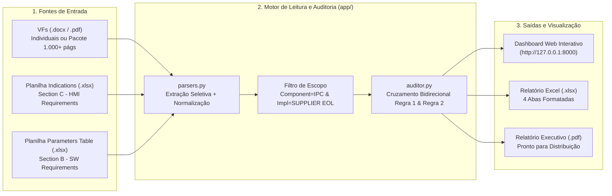

# Especificação Técnica e de Arquitetura (SPECS) — Auditor de Especificações IPC

## 1. Arquitetura do Sistema
O sistema foi construído em arquitetura modular utilizando **Python 3.10+**, **FastAPI** e **HTML5/CSS3/ES6** sem necessidade de banco de dados externo (processamento rápido em memória com geração de artefatos locais).



---

## 2. Especificação das Regras de Negócio

### 2.1. Regra 1 — Consistência Bidirecional: `VF` $\leftrightarrow$ `Indications.xlsx` (HMI Section C)

#### A. Extração na VF (`.docx` e `.pdf`)
- O parser localiza o início de cada VF através dos títulos principais (ex.: `38 VF139 - Airbag Warning Management (VF139_V1_PJ3U)` ou `62 VF143 - Hand Brake Management`).
- Dentro de cada VF, o parser rastreia especificamente a subseção **`Indication Management`** (ex.: `38.12 Indication Management`, `62.12 Indication Management`).
- **Leitura Híbrida (Tabela + Texto Corrido DOORS):**
  - Extrai todas as linhas de tabelas de indicações presentes na seção.
  - Extrai também menções em texto corrido/parágrafos no padrão `<NOME DA INDICAÇÃO>.V<número>` (ex.: `HAND BRAKE.V1`, `AIR BAG FAIL.V1`) para cobrir requisitos exportados em formato textual do DOORS.
- Quando o documento avança para a subseção seguinte (ex.: `62.13 Diagnostic & Fault Management`), a captura de indicações é encerrada para evitar falsos positivos.

#### B. Normalização de Nomenclatura
- Na VF, as indicações utilizam ponto antes da versão (`HAND BRAKE.V1`).
- Na planilha `Indications.xlsx`, utiliza-se espaço antes da versão (`HAND BRAKE V1`).
- **Função `normalize_indication_name(name)`:**
  1. Converte para letras maiúsculas e remove espaços nas extremidades.
  2. Substitui `.V<dígito>` por ` V<dígito>` via expressão regular (`r"\.V(\d+)\b" -> r" V\1"`).
  3. Colapsa múltiplos espaços consecutivos em um único espaço.

#### C. Matriz de Classificação Bidirecional (Regra 1)
| Direção | Condição | Status Gerado | Severidade RAR |
| :--- | :--- | :--- | :--- |
| **VF $\rightarrow$ Planilha** | Indicação existe na planilha `Indications` e a coluna `VFs` contém o ID da VF (`VFxxx`) | `OK` | `OK` |
| **VF $\rightarrow$ Planilha** | Indicação existe na planilha `Indications`, mas a coluna `VFs` aponta para outra VF diferente | `VF_MISMATCH` | `MEDIUM_RAR_RISK` |
| **VF $\rightarrow$ Planilha** | Indicação chamada na VF **não existe** na planilha `Indications` | `MISSING_IN_SHEET` | `HIGH_RAR_RISK` |
| **Planilha $\rightarrow$ VF** | Linha da planilha `Indications` **não é chamada** por nenhuma VF do pacote | `ORPHAN_IN_SHEET` | `HIGH_RAR_RISK` |

---

### 2.2. Regra 2 — Consistência Bidirecional: `VF` $\leftrightarrow$ `Parameters_Table.xlsx` (SW Section B)

#### A. Extração e Filtro de Escopo na VF (`Configuration Parameters Table`)
- O parser localiza a seção `Configuration Parameters` / `Configuration Parameters Table` (ex.: `38.14.1`).
- Caso a tabela contenha apenas `-` (vazia, como ocorre em diversas VFs reais), o sistema registra `0` parâmetros para aquela VF sem gerar erro.
- Para cada linha preenchida da tabela, a função `evaluate_ipc_supplier_eol_filter(component, implementation)` aplica a regra de escopo:
  - **Auditável (`is_ipc_supplier_eol = True`):** `Component` contém `IPC` **E** `Implementation` contém `SUPPLIER` + `EOL` (ex.: `SUPPLIER EOL`, `SUPPLIER EOL_2`).
  - **Segregado / Ignorado (`is_ipc_supplier_eol = False`):**
    - Se `Component != IPC` (ex.: `ORC`, `BCM`, `BSM`) $\rightarrow$ Pertence a outra ECU.
    - Se `Implementation == PROXI` $\rightarrow$ Configurado pela Stellantis na linha de montagem através da especificação PROXI (não entra na `IPC_Parameters_Table` do fornecedor).

#### B. Normalização Numérica de `First Trial Value`
- A função `normalize_numeric_str(val)` converte vírgulas decimais em pontos (`2,5` $\rightarrow$ `2.5`, `4,0` $\rightarrow$ `4`) para comparar valores numéricos de forma exata entre Word/PDF e Excel.

#### C. Matriz de Classificação Bidirecional (Regra 2)
| Direção | Condição | Status Gerado | Severidade RAR |
| :--- | :--- | :--- | :--- |
| **VF (IPC+EOL) $\rightarrow$ Planilha** | Parâmetro existe na `Parameters Table` e `First Trial Value` é válido e equivalente | `OK` | `OK` |
| **VF (IPC+EOL) $\rightarrow$ Planilha** | Parâmetro existe na `Parameters Table`, mas `First Trial Value` está em branco ou diverge da VF | `VALUE_MISMATCH_OR_EMPTY` | `MEDIUM_RAR_RISK` |
| **VF (IPC+EOL) $\rightarrow$ Planilha** | Parâmetro `IPC + SUPPLIER EOL` da VF **não existe** na `Parameters Table` | `MISSING_IN_SHEET` | `HIGH_RAR_RISK` |
| **Planilha $\rightarrow$ VF** | Parâmetro listado na `Parameters Table` **não é utilizado** por nenhuma VF do pacote | `ORPHAN_IN_SHEET` | `HIGH_RAR_RISK` |

---

## 3. Estrutura de Diretórios do Projeto
```text
├── app/
│   ├── __init__.py
│   ├── models.py          # Dataclasses tipadas (VFs, Indicações, Parâmetros, Relatório)
│   ├── parsers.py         # Leitores .docx, .pdf (1.000+ págs) e .xlsx + Auto-Discovery
│   ├── auditor.py         # Motor de auditoria bidirecional (Regras 1 e 2) e cálculo de KPIs
│   ├── exporter.py        # Gerador de relatórios em Excel (.xlsx) e PDF (.pdf)
│   ├── main.py            # Servidor FastAPI e rotas REST
│   └── static/            # Front-End Web Interativo (index.html, styles.css, app.js)
├── docs/
│   ├── BRIEFING_EXECUTIVO.md
│   ├── ESPECIFICACAO_TECNICA_SPECS.md
│   └── MANUAL_DO_USUARIO.md
├── scripts/
│   ├── generate_mock_data.py         # Gerador da amostra rápida (6 VFs)
│   └── generate_large_scale_data.py  # Gerador do pacote de 1.215 páginas (45 VFs)
├── tests/
│   └── test_auditor.py    # Suíte de testes automatizados (pytest)
├── instalar_requisitos.bat
├── iniciar_sistema.bat
├── run_audit_cli.py       # Executor via linha de comando (CLI)
└── requirements.txt
```

---

## 4. Endpoints da API REST (`app/main.py`)
- `GET /` — Interface web principal do **Auditor de Especificações IPC**.
- `POST /api/audit/upload` — Recebe arquivos enviados manualmente pelo usuário (`vf_files` em `.docx`/`.pdf`, `indications_file` em `.xlsx`, `parameters_file` em `.xlsx` e `project_name`) e retorna o JSON completo da auditoria.
- `POST /api/audit/folder` — Recebe o caminho de uma pasta local ou de rede (`folder_path`), localiza automaticamente as subpastas da estrutura Stellantis e executa a auditoria.
- `POST /api/audit/mock?prefer_format=docx|pdf` — Executa a auditoria sobre o conjunto de demonstração rápido (6 VFs).
- `POST /api/audit/large?prefer_format=pdf|docx` — Executa a auditoria sobre o conjunto de demonstração em escala real (**1.215 páginas / 45 VFs**).
- `GET /api/export/excel` — Gera e faz o download do relatório `.xlsx` multi-abas da última auditoria executada.
- `GET /api/export/pdf` — Gera e faz o download do relatório executivo `.pdf` da última auditoria executada.
